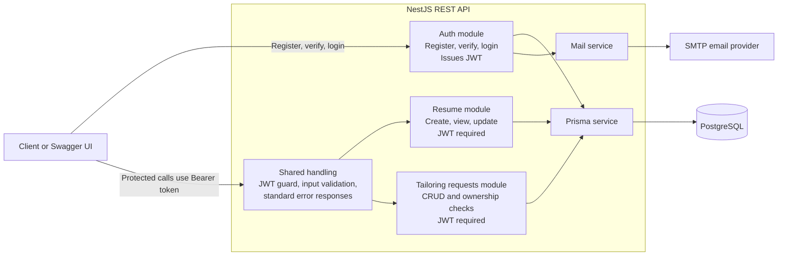
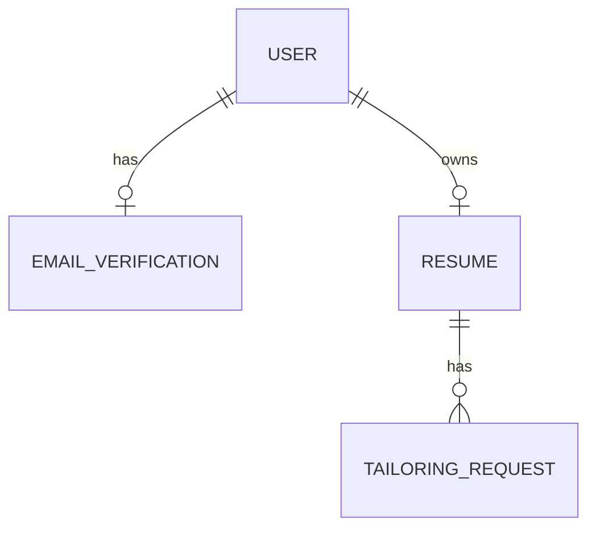

# API Architecture

The API uses the JWT to identify the caller. Resume and tailoring-request operations are scoped to that user through the resume relationship.

When a resume or job description changes, requests with generated results are marked `STALE`. Their result and `generated_at` are retained until the user regenerates the result; successful generation replaces it and returns the request to `COMPLETED`.
