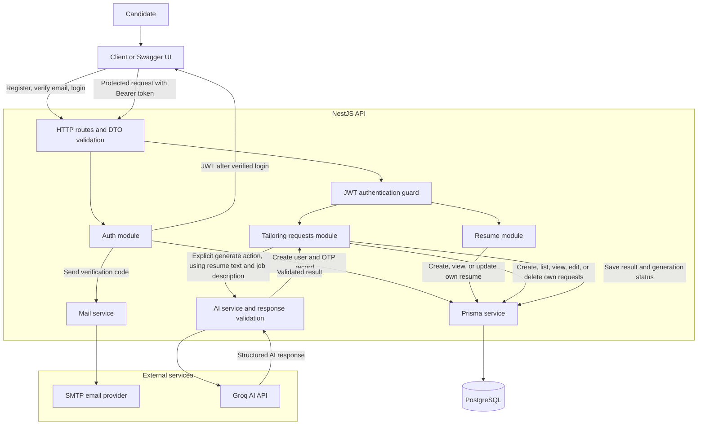

# End-to-End Architecture

## Flow

1. The candidate registers. The API stores a password hash and a hashed, expiring verification code, then sends the code through the mail provider.
2. After email verification, the candidate can log in and receive a JWT. Protected requests send it as a Bearer token.
3. The candidate creates and manages their resume. Resume and tailoring-request operations are scoped to the authenticated user.
4. The candidate creates a tailoring request with a job description. This stores the request; it does not call the AI provider.
5. The candidate calls the separate generate endpoint. The API sends the resume text and job description to Groq, validates the structured response, and saves it on that same tailoring request.

## Data and safeguards

- PostgreSQL stores users, email-verification records, resumes, and tailoring requests. Prisma provides database access.
- A user owns one resume, and a resume can have multiple tailoring requests. Ownership is checked from the tailoring request through its resume to the user.
- Updating a resume or job details marks previously generated results `STALE` while keeping the result available. Regenerating updates that request and marks it `COMPLETED`.
- DTO validation, authentication, rate limiting on auth routes, and the global exception filter apply at the API boundary.
